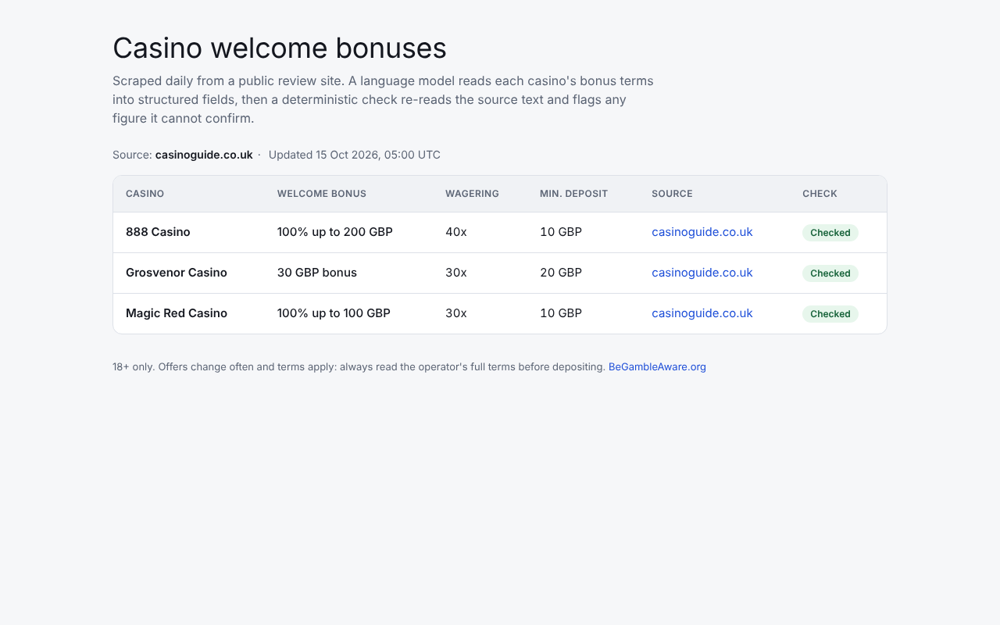
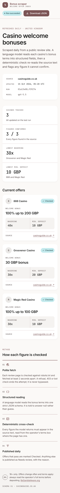

# Casino bonus scraper

Pulls the welcome offer for three online casinos from one public review site, uses a language
model to turn each offer's free-text terms into structured fields, checks the model's answer
against the source text, and publishes the result as JSON and as a mobile-friendly web page.

- **Live page:** https://maribodevs.github.io/-casino-bonus-scraper/
- **Data:** [`data/casinos.json`](data/casinos.json), refreshed daily by
  [a GitHub Actions workflow](.github/workflows/scrape-and-publish.yml)
- **Source:** [casinoguide.co.uk](https://www.casinoguide.co.uk/robots.txt) review pages for
  888 Casino, Magic Red Casino and Grosvenor Casino. Its robots.txt allows them. AskGamblers was tried
  first and answered 403, so it was dropped rather than worked around. Why the third casino is Magic Red
  and not Casumo is in [docs/SUBMISSION.md](docs/SUBMISSION.md).

| Desktop | Phone |
|---|---|
|  |  |

The screenshots are from an earlier run; the live page shows the latest one.

| Field | Example in `casinos.json` |
|---|---|
| Welcome bonus | `"welcomeBonus": "100% up to 200 GBP"` |
| Wagering requirement (multiplier) | `"wageringRequirement": 40` |
| Minimum deposit | `"minimumDeposit": "10 GBP"` |
| Source URL | `"sourceUrl": "https://www.casinoguide.co.uk/888-casino-review"` |

## Run it

You need the [.NET 10 SDK](https://dotnet.microsoft.com/download) and, for the page, Node 22.

```bash
# 1. Scrape (one command). Uses Azure OpenAI; give it an endpoint and deployment, and either
#    an API key or an `az login` session (it falls back to Entra ID when no key is set).
dotnet user-secrets --project src/BonusScraper.Cli set Extraction:AzureOpenAI:Endpoint https://<resource>.openai.azure.com/
dotnet user-secrets --project src/BonusScraper.Cli set Extraction:AzureOpenAI:Deployment <deployment>
dotnet user-secrets --project src/BonusScraper.Cli set Extraction:AzureOpenAI:ApiKey <key>
dotnet run --project src/BonusScraper.Cli -- scrape

# No model key? Replay the model answers recorded on the last run. No key and no cost, but it
#    still fetches the live pages, and a page that has changed since has nothing to replay:
dotnet run --project src/BonusScraper.Cli -- scrape --provider Replay

# Claude instead of Azure OpenAI:
dotnet user-secrets --project src/BonusScraper.Cli set Extraction:Anthropic:ApiKey <key>
dotnet run --project src/BonusScraper.Cli -- scrape --provider Anthropic

# 2. The page (copies data/casinos.json into the build)
cd frontend && npm ci && npm start          # http://localhost:4200

# 3. Or everything at once: SQL Server, Seq, migrator, scraper and page
#    (needs Docker and the model settings from step 1)
dotnet run --project src/BonusScraper.AppHost
```

Exit codes are meant for schedulers: `0` all casinos scraped, `3` some failed but the rest were
published, `1` nothing published (the previous file is left untouched), `2` bad configuration.

```bash
dotnet test BonusScraper.slnx    # 136 unit tests incl. the golden master; the 4 integration tests need Docker
```

## Production plan

The written part is [docs/PRODUCTION.md](docs/PRODUCTION.md), with the Bicep in [`infra/`](infra).

## Five lines on AI

1. Tool: Claude Code for the whole build, with me reviewing each step; the scraper itself calls Azure OpenAI gpt-5.5 (Claude selectable).
2. Where it was wrong: the check it wrote to verify the model's figures treated a review's article text as just as reliable as the operator's own terms box.
3. It showed on the first live run, which flagged Grosvenor as "needs review": its article still described an old 100% match offer, while the terms box said a 30 GBP bonus.
4. I caught it by reading the flagged row against the live page: the model had read the terms box correctly, and it was the check that was wrong.
5. The check now verifies against the operator's terms first and records which text it used, and a golden-master test replays the real model answers so the mistake cannot come back.

## Time taken

The core brief (scraper, JSON, page, README and production plan) was done in about 2 hours. I
then went past the 3-hour cap on purpose, to about 5.5 hours in total over two sittings, on the
verification check, the tests, the daily publishing job and a page redesign. The commit history
shows the order.

## What is missing

- The Azure setup in [`infra/`](infra) is written but not deployed, on purpose: the free
  GitHub setup (Actions for the daily run, Pages for the site) is enough for three casinos.
  Deploying it means pointing the job at the image CI already publishes, and keeping the
  recorded model answers in Blob storage instead of the repository.

## Design notes

### How it works

```
review page ──robots.txt check──► polite fetch ──► parse offer box + bonus section
     │                                                        │
     │                                   free text ◄──────────┘
     ▼                                       │
 refusal / 403 / CAPTCHA                     ▼
 = stop, record failure          language model (strict JSON schema)
                                             │
                                             ▼
                          deterministic cross-check against the same text
                          ─► "Checked" or "Needs review" with reasons
                                             │
                     ┌───────────────────────┼─────────────────────────┐
                     ▼                       ▼                         ▼
             data/casinos.json        SQL Server history         Blob (production)
                     │
                     ▼
            Angular page (GitHub Pages)
```

- **The language model step** ([`Extraction/`](src/BonusScraper.Infrastructure/Extraction)):
  one prompt and one strict JSON schema, used by both Azure OpenAI (structured outputs) and
  Claude (structured outputs with server-side refusal fallback). The page text is passed as
  untrusted data and the model is told to answer `null` rather than guess.
- **The model is not trusted on its own.** [`TermsReader`](src/BonusScraper.Domain/Verification/TermsReader.cs)
  re-reads the text with conservative regular expressions. Every figure the model returns must
  appear in the source, or the offer is published as *Needs review* with the reason. The check
  reads the operator's terms box when the page has one, because review prose goes stale (the
  Grosvenor review still describes last year's offer), and falls back to the article only when
  it must; the page then says "Checked against review text". The full text is stored with
  every offer.
- **Golden master:** [`GoldenMasterTests`](tests/BonusScraper.Infrastructure.UnitTests/GoldenMaster/GoldenMasterTests.cs)
  replays the answers gpt-5.5 actually gave on the first live run through frozen copies of the
  three pages and the real parser, check and publisher, and compares the result with the
  published JSON.
- **Politeness** ([`Crawling/`](src/BonusScraper.Infrastructure/Crawling)): an RFC 9309
  robots.txt parser (longest match, wildcards, `$`, crawl-delay), at least 2 seconds between
  requests to one host, an identifying User-Agent, retries only for transient faults. A 403,
  429 or bot challenge ends the attempt for that page. It is never bypassed.
- **Record and replay:** live answers are saved to `recordings/`, keyed by a hash of the prompt
  version and the exact input, so tests and keyless runs replay real model output and a changed
  page never replays a stale answer.
- **Change detection:** the same key means a live run asks the model only about pages that
  changed. An unchanged page reuses its recorded answer at no cost, and the cross-check still
  runs on it ([`UnchangedPageBonusTermsExtractor`](src/BonusScraper.Infrastructure/Extraction/UnchangedPageBonusTermsExtractor.cs)).
- **Container image:** the [`Dockerfile`](Dockerfile) builds the scraper for the production job;
  CI builds and smoke-tests it on every push and publishes it to GitHub's container registry
  from `main`.

Layout follows clean architecture: `Domain` (value objects, the offer aggregate, the
cross-check), `Application` (Mediator command and handler, `ErrorOr` results, validation and
logging pipeline behaviours), `Infrastructure` (HTTP, parsing, models, Dapper, publishing),
`Migrator` (DbUp scripts), `Cli`, `AppHost` (Aspire), `frontend` (Angular, zoneless, signals,
Tailwind v4 tokens). Decisions are recorded in [`docs/adr`](docs/adr).

The demo is hosted on GitHub Pages because it is free; the production plan uses Azure Static
Web Apps for the custom domain and the Azure-side alerting. Both serve the same build.
